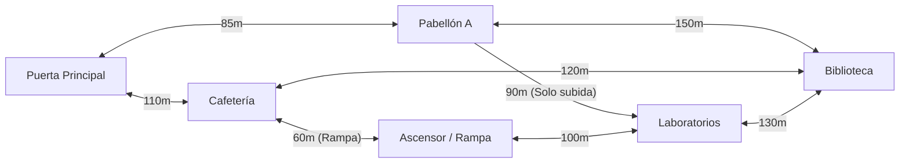

# PA4: Recursividad y grafos aplicados al campus

### Organización del trabajo
| Integrante | Rol |
|---|---|
|CESAR AUGUSTO CHAVERO MEJIAS | Actividad 1|
| JORGE GABRIEL ZUÑIGA SOTO | Actividad  2|
 |ROY ORLANDO GRANADOS AGUILAR| Actividad 3|
|IMANOL HUMBERTO PONCE DE LEON PORTAL | Actividad 3|
| JOSEPT MATTIAS YALAN LARA | Actividad 4 |

## Objetivo del trabajo

Diseñar una propuesta para un módulo inteligente de orientación dentro del campus, que ordene información, analice rutas posibles entre ubicaciones y justifique qué camino resulta más conveniente según el contexto. Para ello, el equipo integra recursividad (divide y vencerás, y ordenamiento con Merge Sort) y grafos (modelado del campus, recorridos DFS y BFS, y el algoritmo heurístico A*), y argumenta qué solución recomienda implementar y cómo se relaciona con aplicaciones básicas de inteligencia artificial.

## Propuesta del equipo

El módulo de orientación combina cada técnica con la tarea que mejor resuelve. Se usa recursividad y Merge Sort para ordenar la información del campus, como las distancias desde la entrada principal. El campus se modela como un grafo ponderado y mixto, con ubicaciones como nodos y pasillos como aristas. DFS verifica la conectividad y las rutas accesibles o de evacuación, y BFS encuentra la ruta con menos tramos. A* es el motor principal de rutas, porque usa el costo real y una estimación hacia la meta para recomendar el camino más conveniente según el contexto.

## Actividad 1. Recursividad aplicada

### 1. Recursividad y su relación con *Divide y Vencerás*

La **recursividad** es una técnica de diseño algorítmico en la que una función o método se invoca a sí mismo para resolver un problema, reduciéndolo progresivamente hacia casos más simples o elementales.

* **Recursividad:** Es el mecanismo (o forma de auto-llamada) mediante el cual se descompone una tarea en instancias menores hasta alcanzar una solución directa.
* **Divide y vencerás:** Es un paradigma que divide un problema en dos o más subproblemas del mismo tipo y menor tamaño, resuelve cada subproblema (usualmente de forma recursiva) y combina sus resultados para construir la solución final.
* **Aplicación en el campus:** Permite particionar catálogos de ubicaciones, horarios o distancias para ordenarlos eficientemente, así como dividir la exploración de zonas y rutas dentro de un campus universitario.

---

### 2. Caso base, caso recursivo y condición de finalización

* **Caso base:**
  * `if (current == null) return false;` — Se alcanzó el final de la secuencia de ubicaciones sin hallar la parada buscada.
  * `if (current.locationId == targetLocationId) return true;` — Se encontró la ubicación solicitada en el nodo actual.
* **Caso recursivo:**
  * `return containsLocation(current.next, targetLocationId);` — Cuando el nodo actual no es nulo ni coincide con el objetivo, el método se llama a sí mismo avanzando al siguiente nodo de la ruta.
* **Condición de finalización:**
  * Al operar sobre una cadena finita de nodos sin ciclos y avanzar un paso (`current.next`) en cada llamada, la recursión garantiza detenerse en un número finito de pasos al llegar a `null` o al encontrar `targetLocationId`.

## Actividad 2. Ordenamiento recursivo

1. Descripción del problema

Para el módulo inteligente de orientación del campus, se necesita organizar las ubicaciones de la institución según la distancia que existe desde la entrada principal.

Para resolver este problema se implementó el algoritmo Merge Sort (ordenamiento por mezcla), que utiliza recursividad y el principio de divide y vencerás para ordenar los datos de menor a mayor distancia.

2. ¿Qué es Merge Sort?

Merge Sort es un algoritmo de ordenamiento que divide un conjunto de datos en partes más pequeñas hasta que cada parte contiene un solo elemento. Posteriormente, combina las partes ordenándolas progresivamente hasta obtener una lista completamente organizada.

Este algoritmo utiliza la recursividad porque se llama a sí mismo para resolver las partes en las que se divide el conjunto original.

## Datos iniciales
1) 150
2) 80
3) 120
4) 50
5) 200

## Resultados despues del ordenamiento
1) 50
2) 80
3) 120
4) 150
5) 200

## Actividad 3. Modelado del problema mediante grafos

### 1. Representación estructural del campus

El entorno físico del campus se modela como un **grafo ponderado y mixto** $G = (V, E)$, donde los componentes del espacio físico se traducen de la siguiente manera:

| Elemento | Representación en el campus | Detalle técnico |
| :--- | :--- | :--- |
| **Nodos ($V$)** | Ubicaciones clave e intersecciones | Puerta Principal, Pabellón A, Biblioteca, Cafetería, Laboratorios, Rampas/Ascensores, Tópico. |
| **Aristas ($E$)** | Pasillos, senderos, escaleras y puentes | Conectan dos nodos adyacentes. Cada arista posee un **peso ($w$)** que representa distancia en metros, tiempo en segundos o nivel de esfuerzo físico. |
| **Sentido (Dirección)** | Flujo de tránsito permitido | **No dirigido** (bidireccional) en patios abiertos y pasillos amplios. **Dirigido** (unidireccional) en torniquetes de ingreso/salida, escaleras de un solo sentido en hora punta o rutas de evacuación. |

#### Diagrama conceptual del grafo (Mermaid)

### 2. Escenarios de aplicación: DFS vs. BFS

* **Cuándo usar DFS (Búsqueda en Profundidad):**
  * **Situación:** **Verificación de accesibilidad universal o rutas de evacuación.** Por ejemplo, comprobar si existe al menos un camino continuo apto para sillas de ruedas (excluyendo aristas con escaleras) desde el tercer piso del Pabellón B hasta la zona segura externa, o detectar áreas que quedaron aisladas por mantenimiento.
  * **Justificación:** DFS profundiza rápidamente por una rama hasta el final antes de retroceder (*backtracking*), lo que requiere poca memoria ($O(h)$, donde $h$ es la profundidad máxima del recorrido) y resulta ideal para validar conectividad completa o enumerar rutas posibles entre dos puntos.

* **Cuándo usar BFS (Búsqueda en Anchura):**
  * **Situación:** **Encontrar el recorrido con la menor cantidad de transbordos o tramos** en un subgrafo donde todos los pasillos tienen un costo uniforme (por ejemplo, desplazarse desde la Puerta Principal hasta la Biblioteca cruzando el mínimo número de pabellones, patios o puertas de control).
  * **Justificación:** Al expandir la búsqueda por niveles concéntricos desde el nodo origen, BFS encuentra el camino más corto en términos de número de aristas antes de explorar niveles más alejados.

### 3. Aporte del algoritmo heurístico A* (A-Estrella)

El algoritmo $A^*$ optimiza la búsqueda orientada a una meta evaluando cada nodo candidato mediante la función de costo total:

$$f(n) = g(n) + h(n)$$

* **$g(n)$:** Costo real acumulado desde el punto de partida hasta el nodo actual $n$ (distancia ya recorrida en metros o tiempo transcurrido).
* **$h(n)$:** Función heurística que estima el costo restante desde el nodo $n$ hasta el destino final (por ejemplo, la distancia euclidiana o en línea recta calculada a partir de las coordenadas $(x, y)$ del plano del campus).

**Valor agregado:** A diferencia de algoritmos no informados como BFS o búsquedas sin orientación geográfica como Dijkstra —que expanden nodos en todas direcciones—, $A^*$ utiliza $h(n)$ como una *"brújula"* para priorizar únicamente los pasillos que acercan físicamente al usuario hacia su destino. Esto reduce considerablemente el espacio de búsqueda, acelera el tiempo de respuesta y encuentra el camino óptimo siempre que la heurística sea admisible (es decir, que no sobreestime el costo real restante).

## Actividad 4. Argumentación final

### 1. Comparación de las alternativas planteadas

**Recursividad y divide y vencerás (Actividades 1 y 2)**

| Criterio | Enfoque recursivo | Enfoque iterativo |
|---|---|---|
| Búsqueda de una ubicación en la ruta (Actividad 1) | `containsLocation(current.next, target)`: caso base claro (`null` o coincidencia) y código corto, O(n) | Un bucle `while` recorre la lista, también O(n), sin consumir pila |
| Ordenamiento de catálogos de ubicaciones, horarios o distancias (Actividad 2) | Merge Sort: divide en mitades, ordena y combina; O(n log n), estable | Ordenamientos simples (burbuja, inserción): O(n²) |
| Ventaja | Expresa el problema de forma natural y escala bien al crecer los datos | Menor uso de memoria |
| Riesgo | Si falta el caso base o la lista es muy larga, hay desbordamiento de pila | Código más largo para problemas jerárquicos |

**Recorridos en el grafo del campus (Actividad 3)**

| Criterio | DFS | BFS | A* |
|---|---|---|---|
| Idea | Profundiza por una rama y retrocede (*backtracking*) | Explora por niveles desde el origen | Prioriza el nodo con menor f(n) = g(n) + h(n) |
| Estructura auxiliar | Pila o recursión | Cola | Cola de prioridad |
| Complejidad | O(V + E) | O(V + E) | Depende de la heurística; con una buena h explora muchos menos nodos |
| ¿Camino más corto? | No garantizado | Sí, en número de aristas (si los pesos son uniformes) | Sí, con pesos, si h es admisible |
| Considera pesos y meta | No | No | Sí: costo real g(n) y estimación hacia el destino h(n) |
| Uso en el campus | Comprobar si existe una ruta accesible o de evacuación; detectar zonas aisladas | Ruta con menos tramos entre la Puerta Principal y la Biblioteca | Ruta más corta (metros, tiempo o esfuerzo) hacia un destino concreto |

### 2. Solución recomendada

Recomendamos implementar el módulo de orientación combinando cada técnica con la tarea que mejor resuelve:

1. **Recursividad y Merge Sort** para procesar y ordenar la información del campus (listas de ubicaciones, horarios y distancias). Son eficientes (O(n log n)) y se mantienen rápidos si el campus crece.
2. **DFS** para validar la conectividad del mapa, por ejemplo comprobar que existe al menos un camino accesible o de evacuación y detectar áreas aisladas por mantenimiento.
3. **BFS** para consultas simples de "menor número de tramos" cuando los pasillos tienen un costo uniforme.
4. **A\*** como motor principal para recomendar la ruta. El caso exige justificar qué camino resulta más conveniente según el contexto, y A* es la única de las tres alternativas que usa el costo real y una estimación hacia la meta. Con una heurística admisible, como la distancia en línea recta a partir de las coordenadas del plano, garantiza el camino óptimo explorando menos nodos. Además, al cambiar los pesos de las aristas (metros, segundos o esfuerzo físico) y respetar los sentidos del grafo mixto (torniquetes, escaleras de un solo sentido), se adapta al contexto del usuario.

**Por qué es mejor que usar una sola técnica:** DFS y BFS no consideran distancias ni destino, así que pueden explorar zonas innecesarias o devolver rutas que no son las más cortas en metros. A* resuelve esa limitación, y la recursividad con divide y vencerás mantiene ordenados y accesibles los datos que alimentan el sistema.

### 3. Relación con aplicaciones básicas de IA

- **Búsqueda informada:** A* es un algoritmo de búsqueda heurística; la heurística h(n) actúa como una "brújula" que guía la búsqueda hacia la meta, y eso aporta la parte inteligente del módulo.
- **Rutas y navegación:** los sistemas de mapas y asistentes de orientación modelan los lugares como grafos y calculan rutas con algoritmos como A*, igual que el módulo propuesto.
- **Sistemas de recomendación:** los grafos también modelan relaciones entre usuarios y servicios, por ejemplo para sugerir lugares del campus según el perfil del estudiante.
- **Ordenamiento en sistemas reales:** Merge Sort se utiliza en motores de búsqueda, bases de datos y sistemas de recomendación para ordenar resultados antes de mostrarlos.

### 4. Conclusión

La recursividad con divide y vencerás permite resolver problemas grandes dividiéndolos en subproblemas simples, y los grafos permiten modelar el campus con sus ubicaciones, pasillos y sentidos de tránsito. La **selección correcta de la técnica** según el problema (recursividad y Merge Sort para ordenar, DFS para conectividad, BFS para menos tramos y A\* para la mejor ruta) mejora la eficiencia, la precisión y la capacidad de justificar el camino recomendado. Por ello, recomendamos implementar el módulo con A* como motor de rutas, apoyado en la recursividad y en los recorridos DFS y BFS para las demás consultas.

