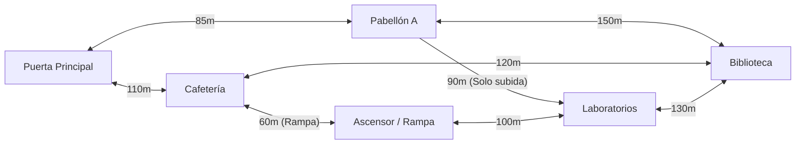

# Pa4

| Integrante | Rol |
|---|---|
|CESAR AUGUSTO CHAVERO MEJIAS | Actividad 1|
| JORGE GABRIEL ZUÑIGA SOTO | Actividad  2|
 |ROY ORLANDO GRANADOS AGUILAR| Actividad 3|
|IMANOL HUMBERTO PONCE DE LEON PORTAL | Actividad 3|
| JOSEPT MATTIAS YALAN LARA | Actividad 4 |

## Actividad 1. Recursividad aplicada

### 1. Recursividad y su relación con *Divide y Vencerás*

La **recursividad** es una técnica de diseño algorítmico en la que una función o método se invoca a sí mismo para resolver un problema, reduciéndolo progresivamente hacia casos más simples o elementales.

* **Recursividad:** Es el mecanismo (o forma de auto-llamada) mediante el cual se descompone una tarea en instancias menores hasta alcanzar una solución directa.
* **Divide y vencerás:** Es un paradigma que divide un problema en dos o más subproblemas del mismo tipo y menor tamaño, resuelve cada subproblema (usualmente de forma recursiva) y combina sus resultados para construir la solución final.
* **Aplicación en el campus:** Permite particionar catálogos de ubicaciones, horarios o distancias para ordenarlos eficientemente, así como dividir la exploración de zonas y rutas dentro de un campus universitario.

---

### 2. Caso base, caso recursivo y condición de finalización

* **Caso base:**
  * `if (current == null) return false;` — Se alcanzó el final de la secuencia de ubicaciones sin hallar la parada buscada.
  * `if (current.locationId == targetLocationId) return true;` — Se encontró la ubicación solicitada en el nodo actual.
* **Caso recursivo:**
  * `return containsLocation(current.next, targetLocationId);` — Cuando el nodo actual no es nulo ni coincide con el objetivo, el método se llama a sí mismo avanzando al siguiente nodo de la ruta.
* **Condición de finalización:**
  * Al operar sobre una cadena finita de nodos sin ciclos y avanzar un paso (`current.next`) en cada llamada, la recursión garantiza detenerse en un número finito de pasos al llegar a `null` o al encontrar `targetLocationId`.

## Actividad 2. Ordenamiento recursivo

## Actividad 3. Modelado del problema mediante grafos

### 1. Representación estructural del campus

El entorno físico del campus se modela como un **grafo ponderado y mixto** $G = (V, E)$, donde los componentes del espacio físico se traducen de la siguiente manera:

| Elemento | Representación en el campus | Detalle técnico |
| :--- | :--- | :--- |
| **Nodos ($V$)** | Ubicaciones clave e intersecciones | Puerta Principal, Pabellón A, Biblioteca, Cafetería, Laboratorios, Rampas/Ascensores, Tópico. |
| **Aristas ($E$)** | Pasillos, senderos, escaleras y puentes | Conectan dos nodos adyacentes. Cada arista posee un **peso ($w$)** que representa distancia en metros, tiempo en segundos o nivel de esfuerzo físico. |
| **Sentido (Dirección)** | Flujo de tránsito permitido | **No dirigido** (bidireccional) en patios abiertos y pasillos amplios. **Dirigido** (unidireccional) en torniquetes de ingreso/salida, escaleras de un solo sentido en hora punta o rutas de evacuación. |

#### Diagrama conceptual del grafo (Mermaid)

### 2. Escenarios de aplicación: DFS vs. BFS

* **Cuándo usar DFS (Búsqueda en Profundidad):**
  * **Situación:** **Verificación de accesibilidad universal o rutas de evacuación.** Por ejemplo, comprobar si existe al menos un camino continuo apto para sillas de ruedas (excluyendo aristas con escaleras) desde el tercer piso del Pabellón B hasta la zona segura externa, o detectar áreas que quedaron aisladas por mantenimiento.
  * **Justificación:** DFS profundiza rápidamente por una rama hasta el final antes de retroceder (*backtracking*), lo que requiere poca memoria ($O(h)$, donde $h$ es la profundidad máxima del recorrido) y resulta ideal para validar conectividad completa o enumerar rutas posibles entre dos puntos.

* **Cuándo usar BFS (Búsqueda en Anchura):**
  * **Situación:** **Encontrar el recorrido con la menor cantidad de transbordos o tramos** en un subgrafo donde todos los pasillos tienen un costo uniforme (por ejemplo, desplazarse desde la Puerta Principal hasta la Biblioteca cruzando el mínimo número de pabellones, patios o puertas de control).
  * **Justificación:** Al expandir la búsqueda por niveles concéntricos desde el nodo origen, BFS encuentra el camino más corto en términos de número de aristas antes de explorar niveles más alejados.

### 3. Aporte del algoritmo heurístico A* (A-Estrella)

El algoritmo $A^*$ optimiza la búsqueda orientada a una meta evaluando cada nodo candidato mediante la función de costo total:

$$f(n) = g(n) + h(n)$$

* **$g(n)$:** Costo real acumulado desde el punto de partida hasta el nodo actual $n$ (distancia ya recorrida en metros o tiempo transcurrido).
* **$h(n)$:** Función heurística que estima el costo restante desde el nodo $n$ hasta el destino final (por ejemplo, la distancia euclidiana o en línea recta calculada a partir de las coordenadas $(x, y)$ del plano del campus).

**Valor agregado:** A diferencia de algoritmos no informados como BFS o búsquedas sin orientación geográfica como Dijkstra —que expanden nodos en todas direcciones—, $A^*$ utiliza $h(n)$ como una *"brújula"* para priorizar únicamente los pasillos que acercan físicamente al usuario hacia su destino. Esto reduce considerablemente el espacio de búsqueda, acelera el tiempo de respuesta y encuentra el camino óptimo siempre que la heurística sea admisible (es decir, que no sobreestime el costo real restante).

